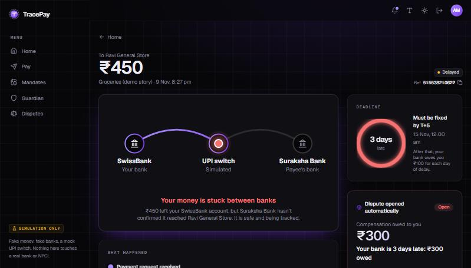
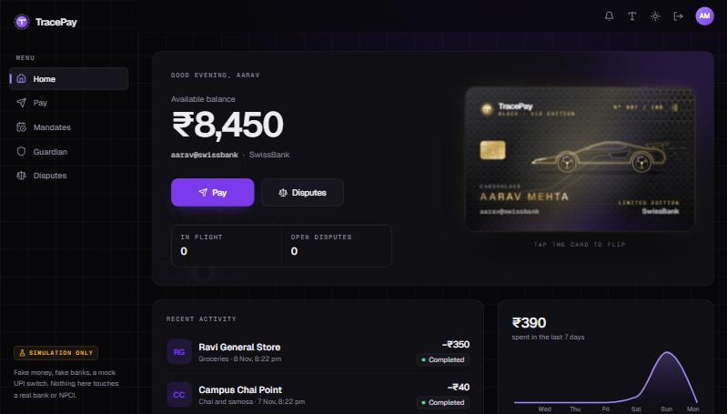
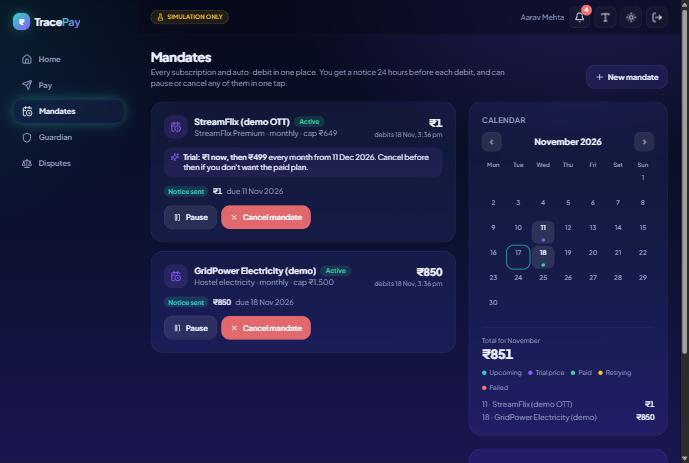
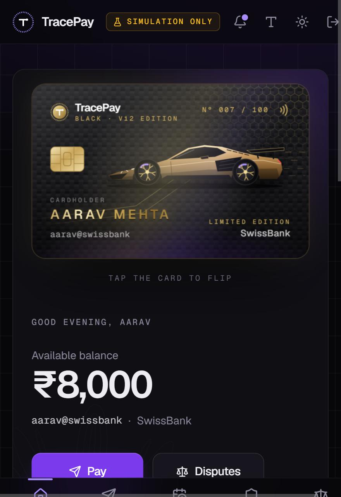
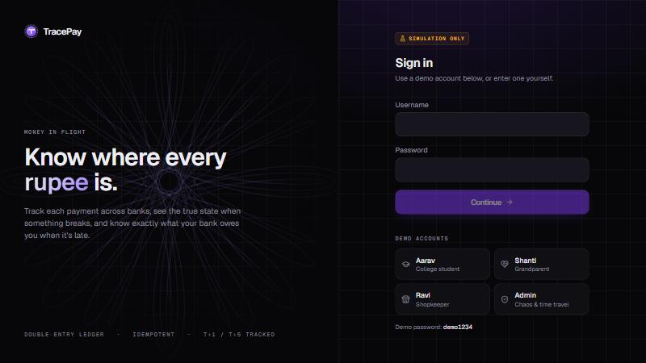
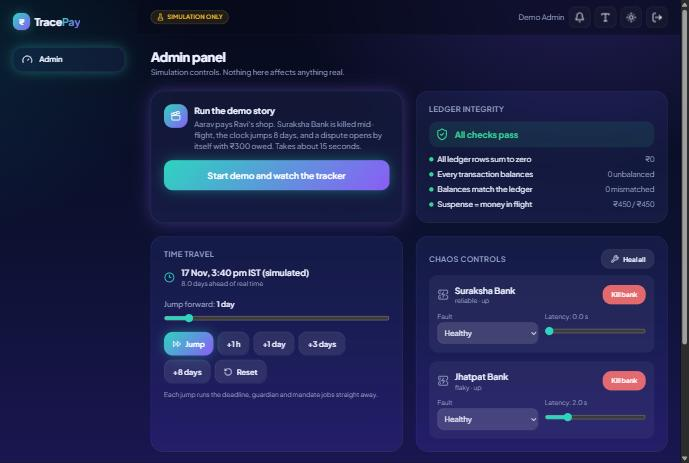
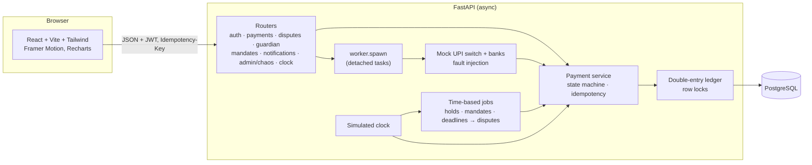
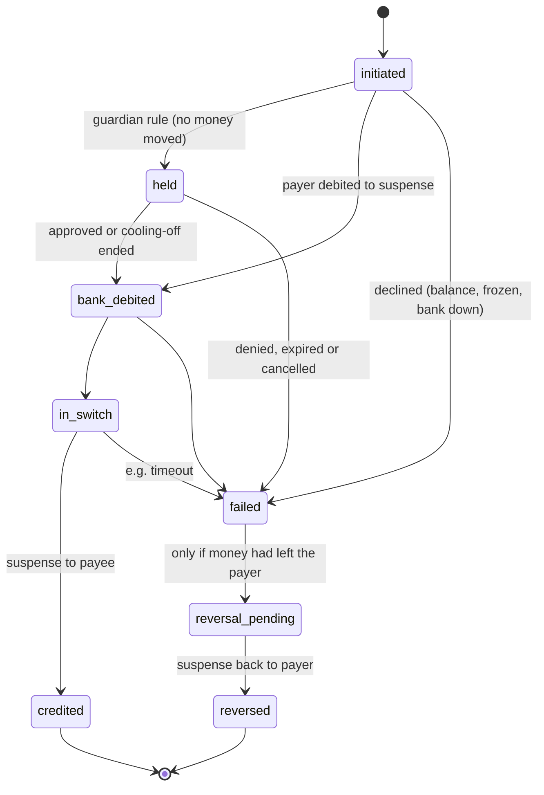
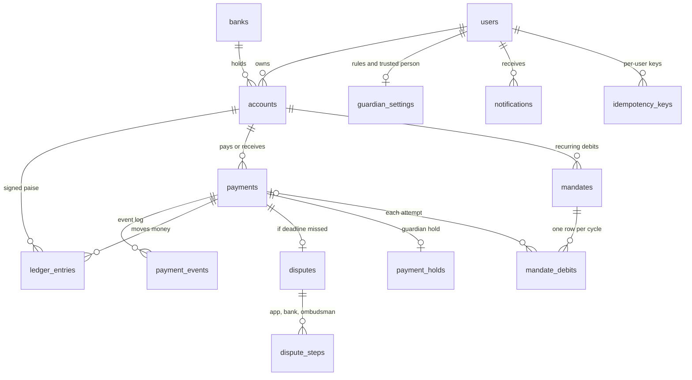

# TracePay: Money in Flight

> **⚠️ Simulation only.** Fake money, fake banks, a mock UPI switch. No real payment
> details, and no real bank or NPCI integration. Every person, bank and merchant is
> fictional.

TracePay is a simulated UPI-style payments platform built around one question: **what
happens to my money after something goes wrong?** It tracks each payment through the
payer's bank, the switch and the payee's bank, and shows the *true* state when a bank
fails mid-flight. When a turnaround deadline passes, it opens a dispute by itself and
works out the compensation your bank owes you.



| Home | Guardian mode | Mandate Manager |
|---|---|---|
|  |  |  |

| TracePay Black · V12 Limited Edition (3D tilt and flip) | Login |
|---|---|
|  |  |

| Admin panel |
|---|
|  |

---

## Contents

- [Run it](#run-it)
- [The demo story](#the-demo-story)
- [Features](#features)
- [Architecture](#architecture)
- [Payment state machine](#payment-state-machine)
- [Data model](#data-model)
- [Design decisions](#design-decisions)
- [Rules modelled on](#rules-modelled-on)
- [Testing and quality](#testing-and-quality)
- [Load test](#load-test)
- [Limitations](#limitations)

## Run it

You need Docker. One command starts Postgres, the API (migrations and demo data are
applied automatically) and the web app:

```bash
docker compose up --build
```

- Web app: http://localhost:5173
- API and interactive docs: http://localhost:8000/docs
- Postgres: `localhost:5433` (user and password `tracepay`)

If port 5173 is taken on your machine, set `WEB_PORT=5174` (see `.env.example`). To start
over with fresh demo data, run `docker compose down -v && docker compose up --build`.
After frontend dependencies change, also renew the web container's `node_modules`:
`docker compose up --build -V web`.

### Demo accounts (password `demo1234` for all; simulation only)

| Username | Who | Bank | Notes |
|---|---|---|---|
| `aarav` | Aarav Mehta, college student | SwissBank (flaky, slow) | Two mandates (one ₹1 trial → ₹499) |
| `shanti` | Shanti Mehta, his grandmother | Suraksha Bank (reliable) | Senior mode on; guardian mode on, with Aarav as her trusted person |
| `ravi` | Ravi Kumar, Ravi General Store | Suraksha Bank | Merchant |
| `admin` | Demo admin | none | Chaos controls, time travel, demo story |

## The demo story

One click (**Admin panel → Run the demo story**) or one command:

```bash
make demo    # or: docker compose exec api python scripts/demo.py
```

1. Aarav pays Ravi General Store ₹450. Ravi's bank (Suraksha) is slow to answer.
2. While the payment is in flight, the demo **kills Suraksha Bank**.
3. When the switch tries to credit Ravi, the bank is down. The tracker shows the truth:
   *"Your money is stuck between banks. ₹450 left your SwissBank account, but
   Suraksha Bank hasn't confirmed it reached Ravi General Store."* The dot pauses at the
   switch and turns amber. The money sits visibly in the suspense account.
4. The simulated clock **jumps 8 days**, past the T+5 merchant deadline.
5. With **no manual action**, the system opens a dispute, writes it to the event log,
   notifies Aarav and shows: **"Your bank is 3 days late: ₹300 owed. This compensation is
   owed by SwissBank, your bank, not by Ravi General Store."** A ready-to-send claim
   summary with every reference is one click away.

Afterwards: Admin panel → **Heal all** and Time travel → **Reset**.

## Features

**1. Money in Flight** (the core)
- Live tracker per payment: an animated flight path (payer's bank → UPI switch → payee's
  bank; amber when delayed, red when late, a return arc for refunds), a plain-language
  status, and the full event timeline.
- A deadline countdown ring based on the turnaround rule (T+1 person-to-person, T+5
  merchant).
- When a deadline passes, a dispute opens automatically, compensation accrues at
  ₹100/day (and is frozen once the money arrives), and the escalation checklist (app →
  bank → RBI Ombudsman after 30 days) records timestamps. The claim summary can be copied
  or downloaded as text.
- Fault injection per payment (pay screen → "Simulate a problem") or per bank (admin):
  timeout, bank down, debited-not-credited, duplicate callback, slow response.

**2. Guardian mode**
- A trusted person, plus rules: approval above an amount, approval for first-time payees,
  and a cooling-off pause for large payments.
- Held payments move **no money**. The trusted person approves or stops them from an
  in-app notification. Approvals expire after 60 minutes; cooling-off holds release
  themselves.
- A one-tap kill switch (freeze or unfreeze) for the user or their trusted person, a
  notification centre, and a senior mode that enlarges the whole UI.
- *Guardian mode reduces risk but cannot stop every coached scam* (the app says so too).

**Design**
- Black and purple, built on a handful of CSS-variable tokens (light mode included).
  Geist for text, Geist Mono for labels and references, tabular figures for money.
- Money motif: a *guilloché*, the engraved line pattern on banknotes, generated in code
  from hypotrochoid curves and slowly rotating on the login screen and the balance card.
- **TracePay Black · V12 Limited Edition**: an interactive 3D card styled like a
  carbon-fibre hypercar (an original shaded bronze-gold car drawn in SVG, no real car brand's name or logo): gold
  detailing, a numbered "Nº 007 / 100" edition, spinning Y-spoke wheels, and the
  cardholder's name in shining gold. It tilts toward the pointer, a reflection follows
  it, and it flips on click or Enter. It deliberately has no card number, expiry or CVV;
  the back says it's a simulation, not a payment card.

**3. Mandate Manager**
- Every recurring debit in one place: next date, amount, cap, trial-to-paid flag, recent
  attempts, and one-tap pause, resume or cancel.
- A pre-debit notice 24 hours before every debit. Failed debits retry on a schedule (6 h,
  then 24 h) and show in the tracker. Also a month calendar and a 6-month projection.

## Architecture



- **API** (`backend/app`): plain modules, one per concept (`payments.py`, `ledger.py`,
  `switch.py`, `disputes.py`, `guardian.py`, `mandates.py`, `jobs.py`, `clock.py`,
  `rules.py`).
- **Async flow:** `POST /payments` accepts and debits in one transaction, replies `201`,
  then a detached task carries the payment through the mock switch. The UI polls the
  tracker.
- **Time-based work** (expiring holds, mandate debits, opening disputes) lives in one
  function, `jobs.run_due_jobs`, called by a 15-second background loop *and* straight
  after every time-travel jump.

## Payment state machine



`app/state_machine.py` is the only code that changes `payment.state`. Every change is
checked against the allowed list and written to `payment_events` with its (simulated)
timestamp. "Stuck" is not a separate state: a stuck payment stays in `in_switch` (or
`reversal_pending`) with *note* events such as "Suraksha Bank is not responding". That's
the honest truth, and the deadline sweep acts on it.

## Data model



All money is **BIGINT paise** (₹1 = 100). Notable constraints:
- `accounts`: a CHECK keeps customer balances ≥ 0 and system balances at 0 (see below).
- `ledger_entries.amount_paise <> 0`; `payments.amount_paise > 0`.
- One dispute per payment (`unique payment_id`), and one debit row per mandate cycle
  (`unique (mandate_id, due_at)`).
- `sim_clock` is a single row (`CHECK id = 1`).

Six Alembic migrations (`backend/alembic/versions`). CI checks that they match the models
(`alembic check`) and roll back cleanly.

## Design decisions

**Why idempotency keys?** Phones lose signal. If a response is lost after the server took
the money, the app retries, and without protection that's a second payment. Every
`POST /payments` carries an `Idempotency-Key`. The key row is inserted *in the same
transaction* as the payment (`INSERT … ON CONFLICT DO NOTHING`):
- A retry replays the saved response (`Idempotent-Replayed: true`).
- A parallel duplicate waits on the unique index, then replays.
- The same key with a different body returns `409`.
- A rejected request rolls back, so its key stays free.

The UI makes one key per payment attempt and reuses it on "Try again". Tests send 20
identical requests at once and get exactly one payment.

**How locking prevents double-spend.** The payer's row is locked
(`SELECT … FOR NO KEY UPDATE`) *before* the balance is read. A second payment from the
same account waits, then sees the reduced balance. The test fires **100 parallel ₹100
payments** at ₹8,450: exactly 84 succeed, 16 are declined, ₹50 is left, and the ledger
sums to zero. A DB `CHECK` constraint is the safety net underneath. Locks are taken in
one global order (payment row, then accounts by id), so crossing payments can't deadlock.

**Two lessons the tests and load test taught (worth asking me about):**
1. **`FOR UPDATE` deadlocked under load.** Inserting a payment or ledger row makes
   Postgres take a `KEY SHARE` lock on the referenced account, and `FOR UPDATE` conflicts
   with that. `FOR NO KEY UPDATE` is the lock mode built for changing non-key columns: it
   still stops double-spends but lets foreign-key checks through.
2. **The suspense account was a hot row.** Every payment updated one shared row, so the
   platform managed about 10 payments/s. Now **system accounts keep no cached balance**:
   their balance is simply the sum of their append-only ledger rows. Only real customer
   accounts are locked. Same correctness, no shared lock (see [Load test](#load-test)).

**Why double-entry?** Every money movement is one transaction with two rows: −amount where
it leaves and +amount where it arrives. Money can't appear or vanish, and rows are never
edited (a refund is a new, opposite transaction). Money in flight lives in a *settlement
suspense* account, so "how much is stuck right now" is a ledger sum. The admin integrity
check proves four things:
- the ledger sums to zero;
- every transaction balances;
- every customer's cached balance matches its ledger rows;
- suspense equals the total of payments in flight.

**Why an injectable clock?** All deadline logic asks `Clock.now()` (real time plus an
offset stored in the DB), never `datetime.now()`. So the demo can jump days ahead, every
worker agrees on the time, and tests freeze time for exact assertions. Login sessions use
real time, so time travel doesn't log anyone out.

**Smaller decisions.**
- Business declines (no balance, frozen account) still create a `failed` payment, like a
  real UPI history.
- Rule values are *copied onto the dispute* when it opens, so changing `rules.py` never
  rewrites an old dispute.
- A dispute never becomes less late than it was when it opened (found in the browser
  after a clock reset).
- Mandate debits are normal payments, so they share the ledger, the switch and the
  tracker.
- Switch work runs as detached tasks (`worker.py`) rather than FastAPI `BackgroundTasks`,
  which kept the connection busy until the slow bank answered.

## Rules modelled on

All values live in **[`backend/app/rules.py`](backend/app/rules.py)**. They are *modelled
on RBI/NPCI rules: verify against the current circular before quoting.* This is a
simulation; values may be outdated or simplified.

| Rule | Value used | Modelled on | Where in `rules.py` |
|---|---|---|---|
| UPI person-to-person, debited but not credited | reverse by T+1, then ₹100/day | RBI TAT harmonisation circular (2019) | `P2P_DEBITED_NOT_CREDITED` |
| UPI merchant, debited but no confirmation | reverse by T+5, then ₹100/day | RBI TAT harmonisation circular (2019) | `MERCHANT_NOT_CONFIRMED` |
| Who owes compensation | the payer's (remitter) bank, not the merchant | same circular | used in `disputes.py` |
| Ombudsman escalation | after 30 days with no resolution from the bank | RBI Integrated Ombudsman Scheme 2021 | `OMBUDSMAN_WAIT_DAYS` |
| E-mandate pre-debit notice | at least 24 h before each debit | RBI e-mandate framework | `PRE_DEBIT_NOTICE_HOURS` |
| E-mandate cap without extra authentication | ₹15,000 per debit | RBI e-mandate framework | `E_MANDATE_MAX_WITHOUT_AFA_PAISE` |
| UPI per-payment limit | ₹1,00,000 | NPCI general limit | `UPI_MAX_PER_TXN_PAISE` |

How they are applied: "T" is the payment's calendar day in IST, the deadline is the end of
day T+N, and a part day of delay counts as a full day. Simulation knobs that are *not*
regulations (approval expiry, cooling-off default, mandate retry hours, slow-response
delay) are in the same file, under clearly separate headings.

## Testing and quality

```bash
docker compose run --rm api pytest -q      # 198 tests against real Postgres
make lint                                  # ruff + mypy + ESLint
```

| Area | What the tests prove |
|---|---|
| State machine | every allowed transition logs an event; **every** other pair is rejected |
| Idempotency | replay, conflicting body (409), per-user scope, formatting-insensitive hash, 20 parallel retries → 1 payment |
| Ledger | sums to zero, balanced transactions, tampering is detected, DB refuses negative or cached system balances |
| Concurrency | 100 parallel payments (84 succeed, 16 declined, ledger = 0); crossing payments don't deadlock; parallel sweeps open one dispute |
| Faults | each fault's outcome; bank killed mid-flight; duplicate callback credits once; refund waits while the payer's bank is down |
| Deadlines and compensation | IST day boundaries, T+1 and T+5, part days, compensation frozen on resolution, a clock reset can't shrink it |
| Guardian | each rule, approve, deny, expiry, cooling-off, cancel, kill switch, permissions, notifications |
| Mandates | notice exactly 24 h ahead, late-notice rule, trial → paid, retries then give-up, pause, resume, revoke, no double charge |
| Demo | the full story ends with "3 days late: ₹300 owed" by the payer's bank |

CI (`.github/workflows/ci.yml`) runs ruff, mypy, migrations (upgrade, check, downgrade,
upgrade), pytest against a Postgres service, ESLint, and the TypeScript build.

## Load test

`loadtest/pay.js` (k6): 20 virtual users, 50 s, three demo users paying each other ₹0.01
in a ring. One in ten iterations replays its request with the same Idempotency-Key and
checks the server returns the saved payment. Run with `make loadtest` (it starts the API
with 4 workers first).

Measured on a Windows laptop (Docker Desktop, 8 vCPUs), API and Postgres in containers:

| Version | Throughput | Median | p95 | Errors | Idempotent replays correct |
|---|---|---|---|---|---|
| 1 worker, suspense account had a cached balance (hot row) | 10.9 req/s | 387 ms | 8.06 s | 0% | 60 / 60 |
| 1 worker, system accounts ledger-only (hot row removed) | 13.0 req/s | 818 ms | 4.46 s | 0% | 68 / 68 |
| **4 workers, hot row removed** | **31.0 req/s** | **378 ms** | **1.65 s** | **0%** | **152 / 152** |

After roughly 4,000 load-test payments, the integrity check still passed: every payment
was credited and the ledger summed to ₹0. The remaining queueing is deliberate: 20 users
share only 3 paying accounts, and payments from *one* account must run one at a time,
because that row lock is what prevents overdrafts.

## Limitations

Honest scope notes for reviewers:

- **Simulation only.** No real banks, NPCI, UPI PINs, devices or KYC. The "switch" is a
  function in this process.
- **Regulations are modelled, not authoritative.** Values are simplified (for example, a
  part day counts as a full day, and calendar days rather than business days). Some
  rules are proposals or old circulars. Verify before quoting anything.
- **Compensation is computed, not paid.** No ledger entry moves compensation to the
  customer.
- **The background work is in-process.** Switch tasks and the job loop live in the API
  process. A restart loses in-flight tasks; the deadline sweep notices any payment left
  stranded, but nothing retries it automatically. Production would use a durable queue
  and an outbox.
- **Auth is demo-grade:** seeded users, a JWT in `localStorage` (an httpOnly cookie
  would be safer), no refresh tokens, no rate limiting, no signup.
- **Guardian mode can't stop a coached victim.** A user can change their own rules. A
  real product might require the trusted person to agree before rules are loosened.
- **Mandates are user-created** (real UPI AutoPay is merchant-initiated, then approved by
  the user). There is no extra-authentication step for amounts above ₹15,000; those caps
  are refused instead.
- **Single currency, single country, single ledger.** No settlement batches between
  banks, no reconciliation files, no partial refunds, no chargebacks.
- **The load test ran on a laptop** with Docker Desktop. The numbers show *relative*
  improvements, not production capacity.

---

Built as a portfolio project. Code layout: `backend/app` (FastAPI), `backend/tests`
(pytest), `frontend/src` (React), `loadtest/` (k6), `docs/screenshots/`.
