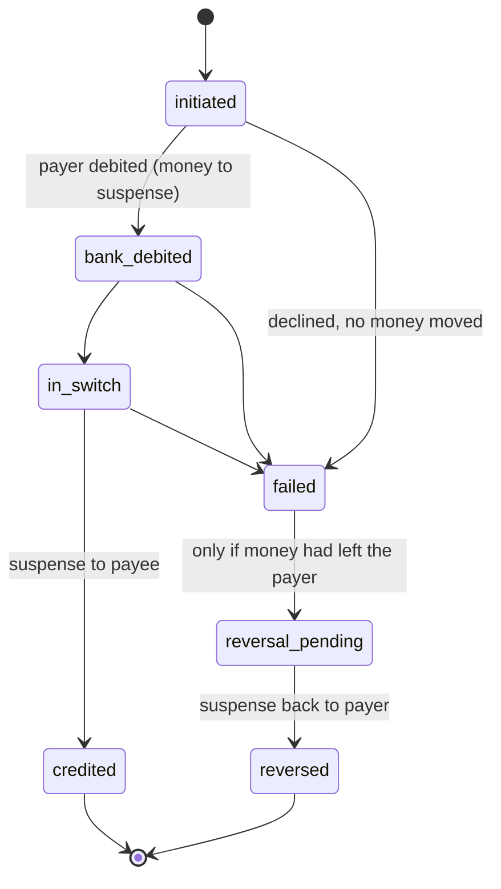

# TracePay: Money in Flight

> **⚠️ Simulation only.** Fake money, fake banks, a mock UPI switch. No real payment
> details, no real bank or NPCI integration.

TracePay is a simulated UPI-style payments platform built around one question: *what happens
to my money after something goes wrong?* It tracks each payment through its stages and shows
when a bank misses its turnaround deadline. The bank then owes compensation, and TracePay
works out how much.

Status: **Phase 5 of 7**: Guardian mode added (trusted-person approvals, cooling-off,
kill switch, notification centre, senior mode). The full README (architecture, design decisions, rules table, limitations) is written
in Phase 7.

## Run it

```bash
docker compose up --build
```

- API: http://localhost:8000 (interactive docs at `/docs`)
- Web: http://localhost:5173
- Postgres: `localhost:5433` (user/password `tracepay`)

On start the API container runs `alembic upgrade head`, then `python -m app.seed` (safe to
repeat), then the server.

After pulling new frontend dependencies, recreate the web container's `node_modules`
volume: `docker compose up --build -V web`.

If you ran an earlier phase, reset the database once, because the seed data changed:
`docker compose down -v && docker compose up --build`. If port 5173 is taken on your
machine, set `WEB_PORT` (see `.env.example`).

### Demo users (password `demo1234` for all, simulation only)

| Username | Who | Bank |
|---|---|---|
| `aarav` | Aarav Mehta, college student | Jhatpat Bank (flaky) |
| `shanti` | Shanti Mehta, his grandmother (trusted person, senior mode) | Suraksha Bank (reliable) |
| `ravi` | Ravi Kumar, Ravi General Store | Suraksha Bank |
| `admin` | Demo admin (chaos controls, time travel) | none |

## API so far

| Method | Path | Who | What |
|---|---|---|---|
| POST | `/auth/login` | anyone | get a JWT for a demo user |
| GET | `/auth/me` | user | profile and accounts |
| POST | `/payments` | user | pay a UPI ID. **Requires an `Idempotency-Key` header** |
| GET | `/payments`, `/payments/{id}` | user | history; one payment with its full event timeline |
| GET | `/payments/{id}/tracker` | user | **Money in Flight**: where the money is, deadline countdown, dispute |
| GET | `/disputes`, `/disputes/{id}` | payer | disputes with compensation owed and escalation steps |
| GET | `/disputes/{id}/claim` | payer | ready-to-send claim summary (plain text) |
| POST | `/disputes/{id}/steps/{step}/complete` | payer | tick off `bank` / `ombudsman` escalation |
| GET | `/clock` | user | current simulated time |
| POST | `/admin/clock/advance`, `/admin/clock/reset` | admin | time travel (also runs the deadline check) |
| GET | `/admin/ledger/integrity` | admin | proves the ledger balances |
| GET/PUT | `/admin/chaos/banks[/{code}]` | admin | bank down / fault / latency |
| POST | `/admin/chaos/reset` | admin | all banks healthy again |
| POST | `/admin/payments/{id}/resolve` | admin | "the bank finally acts": `credit` or `reverse` |
| POST | `/admin/deadlines/sweep` | admin | run the overdue check now |

```bash
# Example: pay Ravi ₹250 (amounts are in paise)
curl -X POST localhost:8000/payments -H "Authorization: Bearer $TOKEN"   -H "Idempotency-Key: $(uuidgen)" -H "Content-Type: application/json"   -d '{"payee_vpa": "ravistore@suraksha", "amount_paise": 25000}'
```

## Fault injection (simulation only)

Set a fault for **one payment** (`"simulate_fault"` in the pay request) or for **every
payment a bank receives** (`PUT /admin/chaos/banks/{code}`):

| Fault | What the mock switch does | Outcome |
|---|---|---|
| `timeout` | payee's bank never answers in time | failed → refunded (or refund waits if the payer's bank is down) |
| `bank_down` / bank `is_down` | payee's bank unreachable when credit is due | stuck in `in_switch`, money in suspense |
| `debited_not_credited` | payee's bank never confirms | stuck in `in_switch`, money in suspense |
| `duplicate_callback` | payee's bank confirms twice | credited once; the second confirmation is logged and ignored |
| `slow_response` | payee's bank waits 8 real seconds | credited late (time to kill the bank mid-flight in a demo) |

If the *payer's* bank is down, the payment is declined before any money moves.
A stuck payment is never auto-"fixed": once its deadline passes, a dispute opens by itself.

## Rules modelled on (all in [app/rules.py](backend/app/rules.py))

Modelled on RBI rules: verify against the current circular before quoting.

| Rule | Value used | Where |
|---|---|---|
| UPI P2P: debited, not credited | reverse by T+1, then ₹100/day | `P2P_DEBITED_NOT_CREDITED` |
| UPI merchant: debited, no confirmation | reverse by T+5, then ₹100/day | `MERCHANT_NOT_CONFIRMED` |
| Ombudsman | after 30 days with no resolution from the bank | `OMBUDSMAN_WAIT_DAYS` |
| Per-payment UPI limit | ₹1,00,000 | `UPI_MAX_PER_TXN_PAISE` |

"T" is the calendar day in IST. The deadline is the end of day T+N, and a part day of delay
counts as a full day. **Compensation is owed by the payer's bank, not by the merchant.**
The app only computes it; nothing pays it out (a limitation).

## How a payment moves (short version; full design notes in Phase 7)



- **Idempotency** ([app/idempotency.py](backend/app/idempotency.py)): the key row is inserted
  in the same DB transaction as the payment. A retry replays the saved response; the same key
  with a different body returns `409`.
- **Locking** ([app/ledger.py](backend/app/ledger.py)): `SELECT ... FOR UPDATE` on the payer's
  row before reading the balance, with rows always locked in ascending id order to avoid
  deadlocks. A DB `CHECK` constraint is the backstop against negative balances.
- **Money in flight** sits in a system *suspense* account between debit and credit, so the
  integrity check can prove every paisa in flight belongs to a specific payment.
- **Lock mode** is `FOR NO KEY UPDATE`, not `FOR UPDATE`: we only change balances, and plain
  `FOR UPDATE` also blocks the `KEY SHARE` locks Postgres takes for foreign-key checks when
  other transactions insert payments or ledger rows pointing at the account. That clash
  deadlocked the 100-parallel-payments test during development.
- **Disputes** ([app/disputes.py](backend/app/disputes.py)): a background loop (every 15 s)
  and every time-travel jump look for money in flight past its deadline, using
  `FOR UPDATE SKIP LOCKED` plus a unique constraint so two sweeps can't open two disputes.
- **Simulated clock** ([app/clock.py](backend/app/clock.py)): real time plus an offset stored in
  the DB; everything that stamps a time asks this clock.

## Tests

Tests use a separate `tracepay_test` database in the same Postgres container.

```bash
docker compose run --rm api pytest -q
```

Or from your machine with the db container running (`docker compose up -d db`):

```bash
cd backend && python -m venv .venv && .venv/Scripts/pip install -r requirements-dev.txt
.venv/Scripts/pytest -q          # use .venv/bin/ on macOS/Linux
.venv/Scripts/ruff check . && .venv/Scripts/mypy app
```

## Data model (so far)

- **users**, **banks**, **accounts**: an account belongs to a bank and has a UPI ID (`vpa`).
- **ledger_entries**: double-entry ledger. A signed amount in paise, where every transaction's
  rows sum to zero. Opening balances come in from a system account, so the whole ledger sums
  to zero from the very first row.
- **payments**, **payment_events**: a payment and its append-only history of state changes.
- **idempotency_keys**: saved results for replayed requests, scoped per user.
- **sim_clock**: a single row holding the simulated clock's offset.

Money is always stored as integer **paise** (BIGINT), never as a float.
