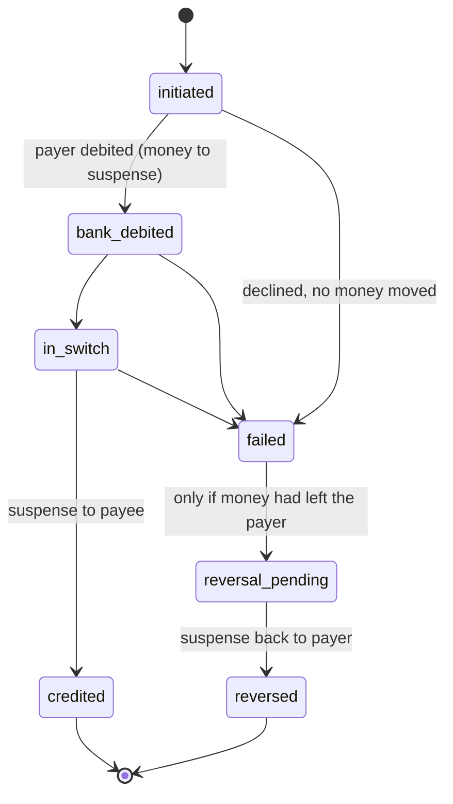

# TracePay: Money in Flight

> **⚠️ Simulation only.** Fake money, fake banks, a mock UPI switch. No real payment
> details, no real bank or NPCI integration.

TracePay is a simulated UPI-style payments platform built around one question: *what happens
to my money after something goes wrong?* It tracks each payment through its stages and shows
when a bank misses its turnaround deadline. The bank then owes compensation, and TracePay
works out how much.

Status: **Phase 2 of 7** (ledger, idempotent payments, state machine, locking, simulated
clock). The full README (architecture, design decisions, rules table, limitations) is written
in Phase 7.

## Run it

```bash
docker compose up --build
```

- API: http://localhost:8000 (interactive docs at `/docs`)
- Web: http://localhost:5173
- Postgres: `localhost:5433` (user/password `tracepay`)

On start the API container runs `alembic upgrade head`, then `python -m app.seed` (safe to
repeat), then the server.

If you ran an earlier phase, reset the database once, because the seed data changed:
`docker compose down -v && docker compose up --build`. If port 5173 is taken on your
machine, set `WEB_PORT` (see `.env.example`).

### Demo users (password `demo1234` for all, simulation only)

| Username | Who | Bank |
|---|---|---|
| `aarav` | Aarav Mehta, college student | Jhatpat Bank (flaky) |
| `shanti` | Shanti Mehta, his grandmother (trusted person, senior mode) | Suraksha Bank (reliable) |
| `ravi` | Ravi Kumar, Ravi General Store | Suraksha Bank |
| `admin` | Demo admin (chaos controls, time travel) | none |

## API so far

| Method | Path | Who | What |
|---|---|---|---|
| POST | `/auth/login` | anyone | get a JWT for a demo user |
| GET | `/auth/me` | user | profile and accounts |
| POST | `/payments` | user | pay a UPI ID. **Requires an `Idempotency-Key` header** |
| GET | `/payments`, `/payments/{id}` | user | history; one payment with its full event timeline |
| GET | `/clock` | user | current simulated time |
| POST | `/admin/clock/advance`, `/admin/clock/reset` | admin | time travel |
| GET | `/admin/ledger/integrity` | admin | proves the ledger balances |

```bash
# Example: pay Ravi ₹250 (amounts are in paise)
curl -X POST localhost:8000/payments -H "Authorization: Bearer $TOKEN"   -H "Idempotency-Key: $(uuidgen)" -H "Content-Type: application/json"   -d '{"payee_vpa": "ravistore@suraksha", "amount_paise": 25000}'
```

## How a payment moves (short version; full design notes in Phase 7)



- **Idempotency** ([app/idempotency.py](backend/app/idempotency.py)): the key row is inserted
  in the same DB transaction as the payment. A retry replays the saved response; the same key
  with a different body returns `409`.
- **Locking** ([app/ledger.py](backend/app/ledger.py)): `SELECT ... FOR UPDATE` on the payer's
  row before reading the balance, with rows always locked in ascending id order to avoid
  deadlocks. A DB `CHECK` constraint is the backstop against negative balances.
- **Money in flight** sits in a system *suspense* account between debit and credit, so the
  integrity check can prove every paisa in flight belongs to a specific payment.
- **Simulated clock** ([app/clock.py](backend/app/clock.py)): real time plus an offset stored in
  the DB; everything that stamps a time asks this clock.

## Tests

Tests use a separate `tracepay_test` database in the same Postgres container.

```bash
docker compose run --rm api pytest -q
```

Or from your machine with the db container running (`docker compose up -d db`):

```bash
cd backend && python -m venv .venv && .venv/Scripts/pip install -r requirements-dev.txt
.venv/Scripts/pytest -q          # use .venv/bin/ on macOS/Linux
.venv/Scripts/ruff check . && .venv/Scripts/mypy app
```

## Data model (so far)

- **users**, **banks**, **accounts**: an account belongs to a bank and has a UPI ID (`vpa`).
- **ledger_entries**: double-entry ledger. A signed amount in paise, where every transaction's
  rows sum to zero. Opening balances come in from a system account, so the whole ledger sums
  to zero from the very first row.
- **payments**, **payment_events**: a payment and its append-only history of state changes.
- **idempotency_keys**: saved results for replayed requests, scoped per user.
- **sim_clock**: a single row holding the simulated clock's offset.

Money is always stored as integer **paise** (BIGINT), never as a float.
